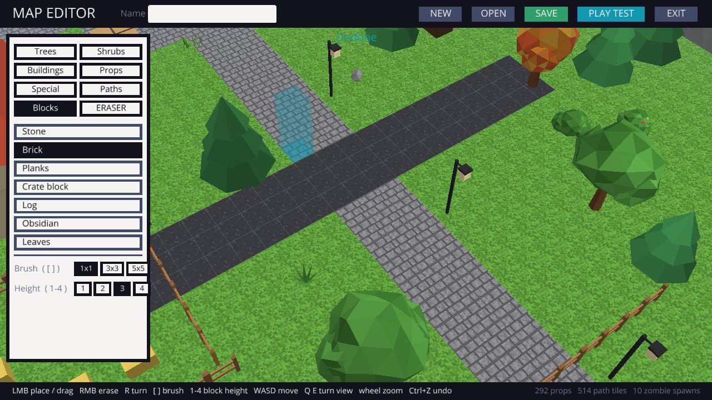

# BLOCKHOLD (Python version)

The same blocky first-person wave survival game, written in Python with the
[Ursina](https://www.ursinaengine.org/) game engine.

## Play

You need [Python 3.10 or newer](https://www.python.org/downloads/). On Windows, tick
**"Add Python to PATH"** when installing.

Open a terminal in this `python` folder, then install the engine (only needed once):

```bash
pip install -r requirements.txt
```

Then start the game:

```bash
python main.py
```

It opens fullscreen. Press **F11** to switch to a window.

**Tip:** get the game with `git clone` instead of downloading a ZIP. Updates then install
with `git pull`, which is the most reliable way (see [Updates](#updates)).

### Controls

| Key | Action |
| --- | --- |
| WASD / arrow keys | move |
| Mouse | look; left click to shoot (hold for automatic weapons) |
| Right mouse | aim down sights (snipers zoom with a scope) |
| Space | jump; hold it against a ledge to climb up |
| Shift | sprint (sprint at low cover to vault over it) |
| C or Ctrl | crouch; press it while sprinting to slide |
| E (hold) | use things, revive a downed ally |
| 1–9 or mouse wheel | switch weapon |
| R | reload |
| Q | use your ability |
| B | shop (between waves) |
| N | start the next wave early |
| M | mute |
| F11 | fullscreen on/off |
| Esc | pause (mouse sensitivity, volume and field of view are here) |
| F8 / F9 | turn / roll a downloaded 3D gun model that's facing the wrong way |

Your best wave, best score and total kills are saved in a `.blockhold` folder in your
home folder.

## Maps and the map editor

Pick a map on the main menu's **MAPS** tab: the random arena, the example maps **Village**
and **Forest Camp**, or one you made. Press **NEW MAP** or **EDIT THIS MAP** to open the
editor.



**The palette (left)** has tabs for the things you can place:

| Tab | What's in it |
| --- | --- |
| Trees | pine, snowy pine, oak, autumn tree, birch, dead tree, stump |
| Shrubs | bush, flower bush, tall grass, fern, flowers, mushrooms, rocks, boulder, hedge |
| Buildings | house, log cabin, ruined house, watchtower, market stall, well, tent, stone wall, fence, sandbags |
| Props | crate, barrel, hay bale, log pile, lamp post, bench, campfire, car wreck, signpost, rubble |
| Special | **zombie grave** (zombies climb out of these) and the **player start** |
| Paths | dirt, gravel, cobblestone, road, sand, wood floor |
| Blocks | stone, brick, planks, crate, log, obsidian and leaves columns, 1–4 high |

**Editor controls**

| Key | Action |
| --- | --- |
| Left click | place. Drag to paint paths, draw lines of fences or walls, or scatter trees and shrubs |
| Right click | erase (whatever the selected tool places) |
| ERASER button | erase everything under the brush |
| R | turn buildings and props 90° |
| [ and ] | brush size 1×1, 3×3, 5×5 (paths, blocks, eraser) |
| 1–4 | block height |
| W A S D / arrows | move the camera |
| Q / E | turn the camera |
| Mouse wheel | zoom |
| Ctrl+Z | undo |
| Esc | leave the editor |

The preview turns red where something won't fit. Trees and shrubs get a random turn and size,
so drag across the map to scatter a forest. **PLAY TEST** drops you into your map, and **Esc →
EDITOR** brings you back. **SAVE** writes `maps/<name>.json`. Change the name at the top to
save a copy instead of overwriting.

If a map has no zombie graves, zombies climb over the outer wall like in the random arena.

**Add your own assets:** everything in the palette lives in `blockhold/data/assets.py`. Each
asset is a short function made of low-poly shapes (boxes, cylinders, cones, lumpy blobs,
roofs, grass blades) plus a list of cells you can't walk through. Copy one, change the
shapes and colours, and it shows up in the editor. Maps are plain JSON, so you can share them
by sending the file.

## Weapons and upgrades

There are 26 weapons, in 8 shop categories:

| Category | Weapons |
| --- | --- |
| Melee | Rusty Wrench, Fire Axe (hits up to 3 enemies) |
| Pistols | Pebble Pistol, Glock 17, M1911, Six-Shooter, Desert Eagle |
| SMGs | Nail Gun, Uzi, Buzz SMG, MP5 |
| Rifles | Ranger Rifle, AR-15 (red dot), AK-47, AS Val (silenced), SCAR-H (goes through 2 enemies) |
| Shotguns | Remington 870, Scattercannon |
| Snipers | Railspike, Barrett M82 (both have a scope) |
| Heavy | Firework Launcher (rockets), M249 SAW (100-round belt), Shredder (minigun) |
| Special | Torch (sets enemies on fire), Frostbite (freezes them), Arc Caster (chain lightning) |

Between waves, the shop's **Weapons** tab lets you buy guns and upgrade each one separately:
damage, fire rate, magazine size and reload speed (melee weapons get reach instead). The
**Player** tab has the upgrades that affect everything: health, power, speed, regen, armor
and more.

### Customize your guns

Open the shop, pick a gun you own and press **CUSTOMIZE**. Each gun has slots for:

| Slot | Attachments |
| --- | --- |
| Optic | Red dot, Holographic sight, 4x Scope (zooms in when you aim) |
| Muzzle | Suppressor (quiet shots, less recoil), Compensator (much less recoil) |
| Underbarrel | Foregrip (steadier aim), Laser (tighter hip-fire) |
| Magazine | Extended mag (50% more ammo, slightly slower reload) |

You buy an attachment once per gun, then swap it on and off for free. Camos (Woodland,
Desert, Arctic, Urban, Tiger, Crimson, Toxic, Galaxy, Gold) are bought once and work on
every gun.

### Allies

The **ALLIES** tab in the shop hires survivors who follow you and shoot zombies:
the Rookie (pistol), Gunner (AR-15), Medic (MP5, heals you when you're close) and Heavy
(M249). You can have 3 at a time. When one goes down, stand next to them and hold **E**
to get them back up. Everyone gets back up at the end of a wave. Their kills earn you coins.

### Secrets

Something is hidden on every map. If you hear whispering, look around...

## Real 3D gun models from Sketchfab

Every weapon has a textured block model. You can swap any of them for a real 3D model from
[Sketchfab](https://sketchfab.com/search?features=downloadable&q=tag%3Agun&sort_by=-likeCount&type=models).

### The recommended pack (one command)

`tools/model_pack.json` lists hand-picked free models for the 12 real guns. Most are from
TastyTony's low-poly series, so they match each other. Each gun has backup models in case
one becomes unavailable.

| Weapon | First choice |
| --- | --- |
| M1911 | [Low-Poly M1911](https://sketchfab.com/3d-models/low-poly-m1911-117f542d21954ae0a59afaedadcff338) by TastyTony |
| AS Val | [Low-Poly AS Val](https://sketchfab.com/3d-models/low-poly-as-val-ed889df2d45c4dd0bcea2e66513c4b57) by TastyTony |
| SCAR-H | [Low-Poly FN SCAR H](https://sketchfab.com/3d-models/low-poly-fn-scar-h-c52bc2a8ddaa47caa34e94d69ff72d96) by TastyTony |
| AK-47 | [Low-Poly AK-47 Type 2](https://sketchfab.com/3d-models/low-poly-ak-47-type-2-a7260926fb0a40f8bba5f651b03d23f1) by TastyTony |
| AR-15 | [Low Poly AR-15](https://sketchfab.com/3d-models/low-poly-ar-15-0b2d1112411f44d3871f9acc327c7a91) by Polyte |
| Glock 17 | [Low-Poly G17](https://sketchfab.com/3d-models/low-poly-g17-60efc54ac59e47d18bdff94b2f5144ff) by TastyTony |
| Desert Eagle | [Low-Poly Desert Eagle](https://sketchfab.com/3d-models/low-poly-desert-eagle-b81da261345f4462b2c4412352162287) by TastyTony |
| MP5 | [Low-Poly HK MP5](https://sketchfab.com/3d-models/low-poly-hk-mp5-80980f757c2c463ebc73460a31611652) by TastyTony |
| Uzi | [Low-Poly IMI Uzi](https://sketchfab.com/3d-models/low-poly-imi-uzi-d9f0070b3c924caf8fe47e41881389f0) by TastyTony |
| Remington 870 | [Low-Poly Remington 870](https://sketchfab.com/3d-models/low-poly-remington-870-4f441ff2e32f4cc19610054daa4beee7) by Wolfosito |
| Barrett M82 | [Low-Poly Barrett M82A1](https://sketchfab.com/3d-models/low-poly-barrett-m82a1-9c7027e5a64e40e9ae927adb0872b6d8) by TastyTony |
| M249 SAW | [Low-Poly M249 SAW](https://sketchfab.com/3d-models/low-poly-m249-saw-76011c365636451c90a8e3a46c2d8ca5) by TastyTony |

You need a free Sketchfab account. Your **API token** is under Settings → Password & API.
Then run:

```bash
python tools/sketchfab_guns.py pack
```

It checks every model's licence on Sketchfab before downloading. If one isn't freely
shareable, it moves on to the backup. Weapons that already have a model are left alone
(add `--force` to replace them). Each download asks for your token the first time and can
remember it.

### Picking your own models

1. Make a free Sketchfab account and copy your API token (see above).
2. Run the downloader and answer its questions:

   ```bash
   python tools/sketchfab_guns.py
   ```

   It lists the most-liked downloadable guns, you pick one, then pick which weapon it
   replaces. It saves the model to `models/<weapon id>/`.
3. Start the game and hold that weapon. The game turns the model so the barrel points
   forward. If it still faces the wrong way, press **F8** to turn it or **F9** to roll it.
   Your fix is saved. To nudge size or position, edit `scale` / `offset` in
   `models/<weapon id>/model.json`.

Other commands: `pack`, `search <words>`, `get <model link> <weapon id>`, `list`,
`remove <weapon id>`.
Run `python tools/sketchfab_guns.py --help` for details.

**Licences:** by default the tool only shows models you're allowed to share: CC0, CC-BY and
CC-BY-SA. CC-BY means you must credit the author. The tool writes `models/CREDITS.md` for
you, and the game shows the credits on the main menu. Use `--license any` to see everything,
but check each model's rules before sharing the game. Your API token is never saved inside
the game folder, so it can't end up on GitHub.

You can also drop your own `.glb`, `.gltf` or `.obj` file into `models/<weapon id>/`.

## Multiplayer (coming later)

Co-op with friends isn't playable yet, but the game is being built for it: every player,
zombie and pickup has a network id, players are driven by input commands, coins and kills
belong to each player, and zombies chase whoever is closest. See
[MULTIPLAYER.md](MULTIPLAYER.md) for the plan and the rules new features follow.

## Updates

On launch, the game checks GitHub for a newer version. If one exists, the main menu shows
**UPDATE NOW** and what's new. Click it and the game updates itself and restarts.

- If you got the game with `git clone`, it runs `git pull`.
- If you downloaded a ZIP, it downloads the new files and copies them over. Any file it
  replaces that you had changed is backed up first in `_backup/<old version>/`.

You can also update from the terminal with `python main.py --update`, or start without
checking using `python main.py --offline`.

**Publishing an update** (for you as the developer):

1. Change the number in `python/VERSION` (for example `1.1.0` → `1.2.0`).
2. Add a `## 1.2.0` section with bullet points at the top of `python/CHANGELOG.md`.
   Players see these bullet points.
3. Push to the repository's default branch on GitHub.

The repository and branch it checks are set at the top of `blockhold/updater.py`.

## Add your own stuff

Everything you'd want to change is in plain, commented Python files in `blockhold/data/`.
Edit them, save, and start the game again. No build step is needed.

| File | What's in it |
| --- | --- |
| `blockhold/data/weapons.py` | every weapon: stats, special effects, block model parts, and the per-weapon upgrades |
| `blockhold/data/enemies.py` | every enemy: health, speed, damage, size, colours, skin look, ranged attacks |
| `blockhold/data/waves.py` | enemies per wave, which types appear, boss timing, special wave modifiers |
| `blockhold/data/upgrades.py` | shop upgrades, prices, and what they do |
| `blockhold/data/abilities.py` | the Q abilities (each is a small Python function) |
| `blockhold/data/gun_models.py` | the detailed gun models, built from parts in code (see `gunsmith.py`) |
| `blockhold/data/attachments.py` | attachments: price, slot and what they change |
| `blockhold/data/allies.py` | hireable survivors: price, health, gun, look |

For example, to add a new gun, copy one of the `dict(...)` entries in `weapons.py`, give it
a new `id` and `name`, and change the numbers. It appears in the shop automatically, with its
own upgrades. Its 3D look is a list of boxes, `(material, size, position)`. The comment at
the top of the file lists every material: steel, wood, rubber grip, brass, camo, glowing
energy and more.

To change how a zombie looks, edit its `colors` and `look` in `enemies.py`: hair colour,
shirt / tank top / vest / robe, blood, scar, mouth, and extra parts like shoulder pads or a
crown. Its skin is painted from those settings automatically.

**Your own sounds:** put `.wav` or `.ogg` files in the `sounds/` folder, named after the
effect (for example `shoot_pistol.wav`). `sounds/README.txt` lists every name.

**Your own UI colours:** the menus use a flat design. Every colour is in the `PALETTE` section
at the top of `blockhold/ui.py`, so changing a few hex codes restyles the whole game. The
icons are drawn in code in `blockhold/textures.py` (look for `_icon_shapes`).

**Your own block looks:** the pixel-art textures (blocks, gun materials and zombie skins)
are drawn in code in `blockhold/textures.py`. Change the colours there, or add a new tile.

### Code map

| File | What it does |
| --- | --- |
| `main.py` | starts the game |
| `blockhold/game.py` | main loop, input, waves, shop, saving |
| `blockhold/world.py` | builds the arena from a map (or at random); collisions and line-of-sight |
| `blockhold/editor.py` | the map editor |
| `blockhold/maps.py` | saving, loading and previewing maps |
| `blockhold/lowpoly.py` | builds the flat-shaded low-poly models |
| `blockhold/data/assets.py` | every placeable asset (trees, buildings, props...) |
| `blockhold/player.py` | movement, jumping and health |
| `blockhold/weapons.py` | shooting, special effects, weapon upgrades and the gun you hold |
| `blockhold/custom_models.py` | loads downloaded 3D gun models and fits them in your hand |
| `blockhold/updater.py` | checks GitHub for updates and installs them |
| `tools/sketchfab_guns.py` | downloads gun models from Sketchfab |
| `blockhold/enemies.py` | enemy models, hit detection and AI |
| `blockhold/projectiles.py` | rockets and enemy spit |
| `blockhold/pickups.py` | coins and health drops |
| `blockhold/effects.py` | particles, tracers, explosions, damage numbers |
| `blockhold/sounds.py` | makes every sound effect with code on first launch |
| `blockhold/ui.py` | HUD, menus and shop (flat design; colours in the PALETTE section at the top) |
| `blockhold/render.py` | the shader (fog) and block mesh helpers |
| `blockhold/textures.py` | pixel-art textures drawn with Pillow |
