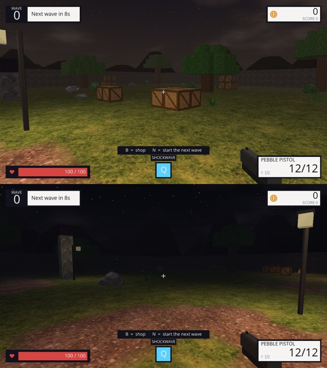
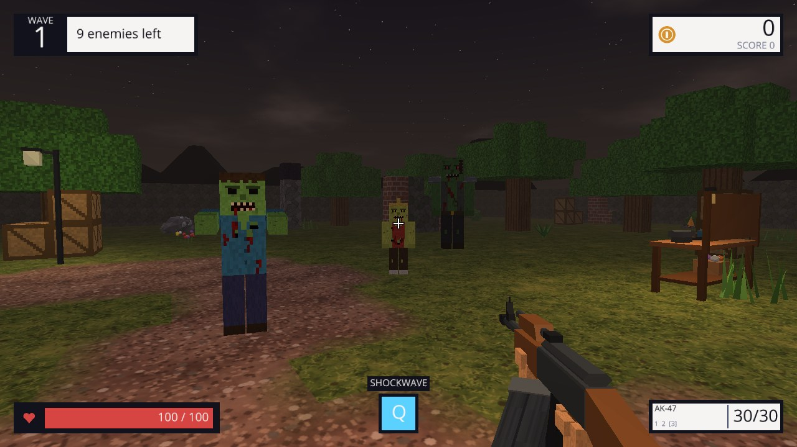
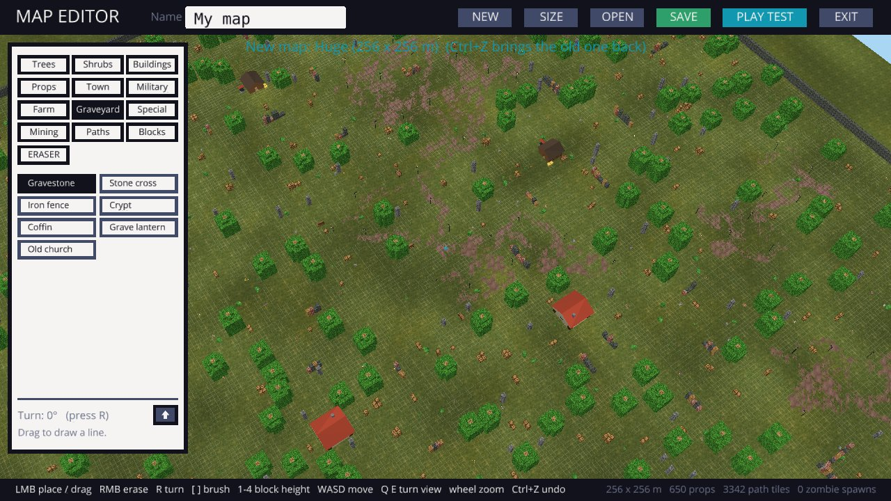
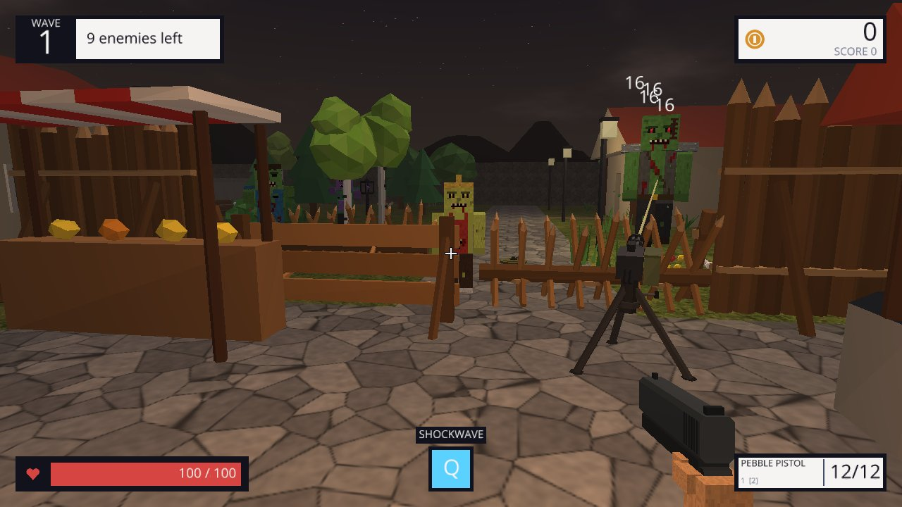

# BLOCKHOLD (Python version)

The same blocky first-person wave survival game, written in Python with the
[Ursina](https://www.ursinaengine.org/) game engine.

## Play

**The easy way (Windows):** download `BLOCKHOLD-Setup-<version>.exe` from the
[Releases page](https://github.com/masterxxstabs/killcraft-remake/releases/latest), run it, and
start BLOCKHOLD from the Start menu. It installs just for you (no admin rights), keeps itself
up to date, and keeps your saves in `%USERPROFILE%\.blockhold`. Prefer no install? Take the
portable zip from the same page. Linux players can grab the `linux.tar.gz`.

**From source** (to change the game or on any other system):

You need [Python 3.10 or newer](https://www.python.org/downloads/). On Windows, tick
**"Add Python to PATH"** when installing.

Open a terminal in this `python` folder, then install the engine (only needed once):

```bash
pip install -r requirements.txt
```

Then start the game:

```bash
python main.py
```

It opens fullscreen. Press **F11** to switch to a window.

**Tip:** get the game with `git clone` instead of downloading a ZIP. Updates then install
with `git pull`, which is the most reliable way (see [Updates](#updates)).

### Controls

| Key | Action |
| --- | --- |
| WASD / arrow keys | move |
| Mouse | look; left click to shoot (hold for automatic weapons) |
| Right mouse | aim down sights (snipers zoom with a scope) |
| Space | jump; hold it against a ledge to climb up |
| Shift | sprint (sprint at low cover to vault over it) |
| C or Ctrl | crouch; press it while sprinting to slide |
| E | talk to an NPC, use a workbench (crafting) or pick up a dropped gun; hold it to revive a downed ally, repair a barricade or refill a turret |
| X | drop the gun you're holding (it keeps its ammo, upgrades and attachments) |
| I | inventory: your pockets, the clothes and armor you're wearing (each piece has its own grid) and the weapons in your hands |
| H | heal: use the bandage / medkit that fits how hurt you are (takes a few seconds; click to stop) |
| G | build mode: place the barricades you crafted (R turns them, the wheel switches, right click stops) |
| 1, 2, 3 or mouse wheel | tool, handgun, rifle (other weapons wait in your inventory) |
| R | reload |
| Q | use your class's ability |
| F | shove: knock the zombies in front of you down (they get back up) |
| K | skill tree: spend the points you get from levelling up |
| B | shop (between waves) |
| Tab (hold) | scoreboard: kills, score and coins for you and your allies |
| N | start the next wave early |
| M | mute |
| F11 | fullscreen on/off |
| Esc | pause (mouse sensitivity, volume and field of view are here) |
| F8 / F9 | turn / roll a downloaded 3D gun model that's facing the wrong way |

Your best wave, best score and total kills are saved in a `.blockhold` folder in your
home folder.

### Devlog

The **DEVLOG** tab on the main menu explains what changed in every version and why, newest first.
It says **NEW** when there's an entry you haven't read. The entries live in `DEVLOG.md`: each one
starts with a line `## version | date | title`, and the text under it is shown in the game.

### Styles, themes and HUD

Under **Settings** pick a **style**: the shape of every screen.

| Style | Look |
| --- | --- |
| Flat | square corners and thick outlines (the original look) |
| Rounded | rounded corners and thinner outlines |
| Soft | big rounded panels and pill-shaped buttons |
| Tactical | cut-off corners, thin outlines and a typewriter font |
| Glass | see-through panels with rounded corners and no outlines |
| Minimal | square and flat, no outlines at all |
| Chunky | extra-thick outlines and small cut corners |

Styles and themes mix freely (Soft + Sunset, Tactical + Military, Glass + Midnight...). Styles
are in `blockhold/data/themes.py` too: corner size, corner shape, outline thickness, how
see-through panels are, and the font.

Then pick a **theme** (colours) for every screen (menus, shop, workbench, pause screen, HUD and
map editor): Classic, Midnight, Military, Neon, Blood Moon, Arctic, Terminal or Sunset. Each theme
button is drawn in its own colours so you can see what you're picking. Themes live in
`blockhold/data/themes.py`; copy one and change the colours to make your own.

**CUSTOMIZE HUD** (in Settings and the pause screen) shows the whole HUD with example values:

- **Drag** any outlined part to move it anywhere on the screen (wave counter, coins, kill feed,
  health bar, power-ups, ability, weapon and ammo, resources, quest tracker, wave banner, boss bar,
  shop hint).
- **Click a part's name** in the panel to switch it on or off (the crosshair too).
- Pick colours for the HUD **panels**, the **accent** (bars, banner, ability), the **health bar** and
  the **crosshair**, and how see-through the panels are. **T** uses the theme's colour.
- **H** hides the panel so you can see behind it; **RESET POSITIONS** puts every part back.

Everything is saved with your settings.

### Atmosphere

By default the game plays at **dusk**, like the original: dark and foggy, with a torch
lighting up the ground around you. Muzzle flashes, explosions, campfires, lamp posts and
glowing crystals light up the world too. Pick **Night** (darker still) or **Day** (bright and
clear) under Settings or in the pause menu. The presets are in `blockhold/data/atmosphere.py`.





## Maps and the map editor

Pick a map on the main menu's **MAPS** tab: the random arena, the example maps **Village**
and **Forest Camp**, or one you made. Press **NEW MAP** or **EDIT THIS MAP** to open the
editor.

### Huge maps

Maps can be anything from 24 x 24 m up to **512 x 512 m**. With the random arena selected,
pick its size under **ARENA SIZE**: Small (40 m), Normal (68 m), Large (128 m), Huge (256 m)
or Giant (400 m). Bigger arenas get more of everything: trees, ruins, tracks, workbenches, ore
nodes, and little scenes to find (farmhouses, camps, watchtowers, car wrecks).

On big maps zombies don't walk in from the far edges: they climb out of zombie graves near
you, or out of the ground 24 to 42 m around you if there are none close. A zombie you leave far
behind digs down and comes back near you. Far-away parts of the map are hidden in the fog so
big maps stay playable (expect a somewhat lower frame rate than on small maps).




**The palette (left)** has tabs for the things you can place:

| Tab | What's in it |
| --- | --- |
| Trees | pine, tall pine, snowy pine, oak, willow, autumn tree, birch, sapling, dead tree, stump, fallen log |
| Shrubs | bush, berry bush, rose bush, sunflowers, wheat, cattails, dead grass, ivy wall, pond, flower bush, tall grass, fern, flowers, mushrooms, rocks, boulder, hedge, dead bush |
| Buildings | house, log cabin, ruined house, abandoned house, burnt-out house, boarded-up shop, collapsed garage, watchtower, market stall, well, tent, stone wall, fence, sandbags |
| Props | crate, barrel, hay bale, log pile, lamp post, bench, campfire, car wreck, signpost, rubble |
| Town | pickup truck, bus wreck, abandoned car, police car, ambulance, traffic cone, road barrier, stop sign, road sign, traffic light, street light, fire hydrant, mailbox, phone booth, news stand, parking meter, dumpster, trash can, trash bags, utility pole, bus stop, gas pump, gas station, billboard, vending machine, picnic table, shopping cart, tire stack, pallet stack, chain-link fence and gate, privacy fence, broken fence, garden shed, swing set, slide, trash pile, parking lot, parking space, wheel stop, parking sign, broken wall, corner shop, apartment block |
| Military | shipping container, army truck, armored jeep, tank wreck, helicopter wreck, guard tower, bunker, army tent, checkpoint gate, sandbag wall, hesco barrier, barbed wire, tank trap, ammo crate, supply pallet, weapon rack, fuel drums, jerry cans, generator, field gun, radar dish, radio mast, floodlight, helipad, camo net, burning barrel |
| Farm | barn, silo, windmill, water tower, scarecrow, tractor, wheelbarrow, outhouse, corn, pumpkins, picket fence |
| Graveyard | gravestone, stone cross, iron fence, crypt, coffin, grave lantern, old church |
| Church | pews, altar, lectern, candle stand, stained-glass wall, bell tower, church gate, confessional |
| Animals & NPCs | deer, pig, chicken and random **animal spawners**, and **NPCs**: trader, quest giver, talker |
| Zones | **zombie level zones**, **random encounter zones**, **safe zones** and **extraction points** (see below) |
| Hideout | underground tunnel pieces (straight, corner, T, crossing, dead end), blast door, vault door, bank counter, merchant stall, support beams, wall pipes, hanging and wall lamps, mine rails and a minecart, lockers, bunk beds, supply shelves, stash box, ventilation fan, water tank, radio desk, exit ladder, tarp curtain |
| Special | **zombie grave** (zombies climb out of these) and the **player start** |
| Mining | workbench, ore / log pile spawns, and **loot crates** (break them for resources and scrap) |
| Loot | barrel spawns (break them for scrap), toolbox, medical box, military crate, clothes rack (search them with E) |
| Caves | dig a cave: set its depth, width, rock height and side tunnels, then click where the entrance goes |
| Paths | dirt, gravel, cobblestone, road, sand, wood floor |
| Blocks | stone, brick, planks, crate, log, obsidian and leaves columns, 1–4 high |

**Editor controls**

| Key | Action |
| --- | --- |
| Left click | place. Drag to paint paths, draw lines of fences or walls, or scatter trees and shrubs |
| Right click | erase (whatever the selected tool places) |
| ERASER button | erase everything under the brush |
| R | turn buildings and props 90° |
| Z / X | turn 15° either way (hold Shift: 1°) |
| T / G | tilt forward / back 15° |
| Y / H | roll left / right 15° |
| Ctrl+click | pick something you already placed, to turn it (Delete removes it, Esc lets go) |
| N | edit the settings of the NPC, zone or zombie grave you picked |
| [ and ] | brush size 1, 3, 5, 9 or 15 cells across (paths, blocks, eraser) |
| 1–4 | block height |
| W A S D / arrows | move the camera |
| Q / E | turn the camera |
| Mouse wheel | zoom |
| Ctrl+Z | undo |
| Esc | leave the editor |

**NEW** asks how big the map should be (a preset or any size in 8 m steps, up to 512 x 512 m),
whether it has walls, and whether to start from empty ground or a random arena you can edit.
**SIZE** makes the current map bigger or smaller; everything stays centred and anything outside
the new size is removed (Ctrl+Z brings it back). On big maps the camera zooms out further.
Phone booths, vending machines, floodlights, radio masts and grave lanterns light up at night.

**Turning things any way you like.** The **ROTATION** panel (top right) has sliders for **Turn**
(any angle around the vertical axis), **Tilt** (lean forward or back) and **Roll** (lean
sideways), plus -15° / +15° / 90° / RESET buttons. It sets how the next thing you place is turned;
**Ctrl+click** something already on the map to turn that instead. The parts you can't walk through
follow the turn to the nearest 90°; tilt and roll only change how it looks (a leaning wreck, a
fallen sign...). Maps save tilt and roll only for things that use them.

The preview turns red where something won't fit. Trees and shrubs get a random turn and size,
so drag across the map to scatter a forest. **PLAY TEST** drops you into your map, and **Esc →
EDITOR** brings you back. **SAVE** writes `maps/<name>.json`. Change the name at the top to
save a copy instead of overwriting.

If a map has no zombie graves, zombies climb over the outer wall like in the random arena.

**Caves.** On the **Caves** tab, set the cave you want, then click on the map where the
entrance should be:

| Setting | What it does |
| --- | --- |
| Depth | how far the main tunnel winds in (8 to 120 m) |
| Width | how wide the tunnels are (2 to 7 m) |
| Rock height | how tall the rock hill is; the roof is 1 m lower (3 to 7 m) |
| Side tunnels | branches off the main tunnel (0 to 5), each ending in a chamber |
| Lanterns, ore, crate, grave | lanterns along the way, ore and a loot crate in every chamber, and a zombie grave at the far end |

The map is flat ground, so a cave is a rock hill with winding tunnels and a roof you walk under
(not a hole into the ground). Every cave is different: Ctrl+Z and click again for another one. Erase
or reshape parts with the ERASER and the Blocks tab. If the cave adds ore spawns, ore only grows at
spawn markers on that map, so add a few outside too.

**Animals.** Put an animal spawner down and a few deer (3), pigs (3) or chickens (4) live around
it; the random spawner picks one kind. They wander, stop to graze, and run when a player or a zombie
gets close (deer are the shyest; crouch to sneak up on them). Shoot or hit one for **raw meat**
(chickens also drop feathers, deer a hide). A new one comes back to the spawner after a minute or so.
Random arenas get a few herds of their own.

**NPCs.** Place a trader, quest giver or talker and the **EDIT NPC** panel opens (or Ctrl+click an
NPC and press **N**). It works like the Custom NPCs mod's edit screen, with four tabs:

| Tab | What you set |
| --- | --- |
| LOOK | name, role (trader / quest giver / talker), skin, shirt, trousers and hair colours, a hat (cap, helmet, cowboy hat, beanie, hood), beard, goggles, apron, or start over from a ready-made NPC |
| DIALOGUE | the greeting, up to four lines they say when you pick TALK, and their goodbye |
| TRADES | up to six swaps: what the player gives (items or coins) and what they get (items, coins or a weapon) |
| QUEST | the job: bring N of an item, kill N zombies or hunt N animals; the reward (coins and / or an item); whether it repeats; and what they say when they offer it, while you're working on it and when you're done |

The NPC in the map changes as you edit. In a game, walk up to an NPC and press **E**: they turn
to you and say their greeting, with buttons for **TALK**, **TRADE** (traders), **JOB** (quest
givers) and **BYE**. Accept a job, do it, and come back to hand it in. NPCs are saved with the map.

**Zones and zombie levels** (Zones tab). Zones are flags with a coloured ring showing their size.
Placing one opens its settings; Ctrl+click it and press **N** to change them later.

| Zone | What it does | Settings |
| --- | --- | --- |
| Zombie level zone (orange) | zombies that spawn inside get a level between its lowest and highest. Where zones overlap, the smallest wins | radius, lowest and highest level |
| Random encounter zone (red) | when a player walks in, there's a chance a group of zombies claws out of the ground 6-12 m away. They don't count towards the wave | radius, chance, cooldown, group size, which zombies, level |
| Safe zone (green) | zombies never spawn inside; no PvP in multiplayer. Its edge shows in the game too | radius |
| Extraction point (blue) | where you'll leave a raid with your loot (coming with the extraction mode) | radius, time to extract, name |

A **zombie grave** has a level setting too (0 = use the zone it's in), so you can set zombie levels
by hand. Each level adds 22% health, 10% damage and a little speed, and 20% more XP and coins. Aim
at a zombie to see its name, level and health under the crosshair.

**Hideout** (Hideout tab). Tunnel pieces are 5 x 5 m with 3 m of floor between solid walls; put them
end to end on the grid and turn them with R to dig out an underground base. Hanging and wall lamps
light it up; try the Night atmosphere.

**Loot crates** (Mining tab) and **barrels** (Loot tab) break when you hit or shoot them, and leave a
sack with what was inside: resources and scrap from crates, scrap parts from barrels. They come back
about a minute later. The **Loot** tab also has containers you search with **E**: toolboxes (springs,
gears, screws, gunpowder), medical boxes, military crates (gun bodies, armor, rigs) and clothes racks
(clothes and backpacks). An emptied container fills up again 2 to 4 minutes later, but only while
nobody is within 15 m of it. Random arenas get some of each. Loot tables are in `blockhold/data/loot.py`.

**Add your own assets:** everything in the palette lives in `blockhold/data/assets.py`. Each
asset is a short function made of low-poly shapes (boxes, cylinders, cones, lumpy blobs,
roofs, grass blades) plus a list of cells you can't walk through. Copy one, change the
shapes and colours, and it shows up in the editor. Maps are plain JSON, so you can share them
by sending the file.

## Zombies

Eleven kinds of zombie (plus a secret one), each new one joining the waves a little later:

| Zombie | From wave | What it does |
| --- | --- | --- |
| Shambler | 1 | slow, arms out, the basic zombie |
| Crawler | 2 | no legs to stand on: drags itself along the ground, low and hard to hit |
| Sprinter | 3 | fast and fragile |
| Brute | 4 | huge, tough, hits hard; only stumbles when you shove it |
| Bloater | 5 | covered in boils; **pops when it dies**, hurting everything close and leaving a toxic cloud. Kill it from a distance |
| Spitter | 6 | spits acid from range |
| Leaper | 7 | **pounces** at you from 4 to 11 m away; shove it out of the air |
| Screamer | 8 | stops and **shrieks** when it sees you: nearby zombies go into a frenzy (45% faster) and more claw out of the ground. Kill it first |
| Riot Zombie | 10 | riot helmet and vest: body shots and melee do only 30%. **Aim for the face**. Shoves don't knock it down |
| Firefighter | 12 | can't be set on fire, and explosions do half damage |
| The Hollow King | every 5th wave | the boss |

All of them, and the waves they come in, are in `blockhold/data/enemies.py` and `waves.py`.

## Classes, levels and skills

Pick a **class** on the main menu. It decides your **Q ability**, gives you a passive bonus, and
has its own column in the skill tree:

| Class | Passive | Q ability |
| --- | --- | --- |
| Soldier | +10% damage, 15% faster reloads | **Adrenaline**: double fire rate, +50% speed and 30 health for 7 s |
| Brawler | +30 health, shoves twice as strong, +25% melee damage | **Shockwave**: 120 damage and a huge knockback around you |
| Scout | +12% speed, 2 more shoves before you tire, +20% headshot damage | **Blink**: teleport 9 m forward |
| Medic | bandages and kits 40% faster, +1 health per second | **Field Heal**: heal 40 now and 6/s for 6 s, heal allies, get downed ones up |
| Engineer | barricades and turrets +50% health | **Sentry**: drop an auto-turret that fights for 25 s |

**Levels.** Kills give XP (a shambler 10, a brute 40, a boss 500+; knocked-down kills +5), every
cleared wave gives 25 x the wave number, and NPC jobs 150. Each level is a **skill point**. The
level badge next to your health shows your level, the thin gold bar under the health your XP, and a
**K** appears when you have points to spend. Your level, XP and skills are **saved** and carry over
to every game. Skills in another class's column stay learned but only work while you play that
class, and **RESET SKILLS** on the skill screen gives every point back.

**The skill tree (K).** Four columns of four skills; a skill opens up once the one above it has a
point, and most take a few points:

| Column | Skills |
| --- | --- |
| Combat | Marksman (+damage), Quick Hands (reloads), Deadeye (headshots), Hair Trigger (fire rate) |
| Survival | Tough (+health), Thick Skin (armor), Second Wind (regeneration), First Aid (heal faster) |
| Defense | Strong Arms (shove power), Stamina (more shoves), Bash (shove damage), Sweep (wider shoves) |
| Your class | four skills of its own: e.g. the Brawler's Ground and Pound (+40% damage to knocked-down zombies) or the Engineer's Twin Sentries |

Everything (classes, skills, XP numbers) is in `blockhold/data/classes.py`.

### Shove (F)

Like Left 4 Dead and Project Zomboid: press **F** to shove the zombies in front of you. Normal
zombies are knocked off their feet: they go limp (a ragdoll), lie there for a couple of seconds,
climb back up and come at you again. While they're down you can shoot them, hit them with melee
(just face them, no need to look down) or shove them again. Big zombies only stumble back, and
bosses barely move. Shoves do a little damage (more with Bash).

Shoving tires you out: you get 4 good shoves in a row (more with Stamina or as a Scout), then
they're slow and weak until you catch your breath. The blue bar over your health shows how much
you have left, red means you're worn out.

## Weapons and upgrades

There are 41 weapons, in 8 shop categories (every one can also be crafted at a workbench):

| Category | Weapons |
| --- | --- |
| Melee | Rusty Wrench, Pickaxe, Baseball Bat (big knockback), Machete (fast), Fire Axe (hits up to 3), Sledgehammer (slow, hits 3, smashes rock), Katana (hits 4) |
| Pistols | Pebble Pistol, Glock 17, M1911, Six-Shooter, Desert Eagle |
| SMGs | Nail Gun, Uzi, Buzz SMG, MP5, P90 (50 rounds), KRISS Vector (very fast, low recoil) |
| Rifles | Ranger Rifle, AR-15 (red dot), AK-47, AS Val (silenced), SCAR-H and M14 (go through 2 enemies) |
| Shotguns | Double Barrel (two huge blasts), Remington 870, Scattercannon, AA-12 (full auto) |
| Snipers | Railspike, Mosin-Nagant (pierces 3), Barrett M82 (all have a scope) |
| Heavy | M79 Grenade Launcher, Firework Launcher (rockets), M249 SAW (100-round belt), Shredder (minigun) |
| Special | Blaster and Blaster Repeater (plasma that singes), Crossbow (pierces every enemy in a line), Torch (sets enemies on fire), Frostbite (freezes them), Arc Caster (chain lightning) |

The Blaster and Blaster Repeater use real 3D models from Kenney's
[Starter Kit FPS](https://github.com/KenneyNL/Starter-Kit-FPS) (MIT License, see
`assets/models/`). The rest are built in code in `blockhold/data/gun_models.py`.

Between waves, the shop's **Weapons** tab lets you buy guns and upgrade each one separately:
damage, fire rate, magazine size and reload speed (melee weapons get reach instead). The
**Player** tab has the upgrades that affect everything: health, power, speed, regen, armor
and more.

### Customize your guns

Open the shop, pick a gun you own and press **CUSTOMIZE**. Each gun has slots for:

| Slot | Attachments |
| --- | --- |
| Optic | Red dot, Holographic sight, 4x Scope (zooms in when you aim) |
| Muzzle | Suppressor (quiet shots, less recoil), Compensator (much less recoil) |
| Underbarrel | Foregrip (steadier aim), Laser (tighter hip-fire) |
| Magazine | Extended mag (50% more ammo, slightly slower reload) |

You buy an attachment once per gun, then swap it on and off for free. Camos (Woodland,
Desert, Arctic, Urban, Tiger, Crimson, Toxic, Galaxy, Gold) are bought once and work on
every gun.

### Allies

The **ALLIES** tab in the shop hires survivors who follow you and shoot zombies:
the Rookie (pistol), Gunner (AR-15), Medic (MP5, heals you when you're close) and Heavy
(M249). You can have 3 at a time. When one goes down, stand next to them and hold **E**
to get them back up. Everyone gets back up at the end of a wave. Their kills earn you coins.

Allies also have your back: if your health runs out while one of them is still standing, you
go **down** instead of dying. You can crawl and keep shooting while the closest ally runs over
to revive you. If nobody gets to you within 25 seconds, or every ally is down too, it's game over.

### Mining and crafting

Rocks with ore in them (**ore nodes**) are spread around the map. Hit one with a melee weapon to
mine it: every hit gives you some of its resources, and it breaks when it's empty. It grows back
about a minute later. The **Pickaxe** mines 2.5x faster (craft it from 25 stone, or buy it).

| Node | Gives |
| --- | --- |
| Stone | stone |
| Iron ore | iron and some stone |
| Copper ore | copper and some stone |
| Crystal (rare, purple) | crystal and some stone |
| Log pile | wood (the Axe chops 3x faster) |
| Coal (dark rock) | coal (fuel for the furnace) and some stone |

What you mine goes in your inventory (**I**). Walk up to a **workbench** and press **E** to craft:

- **Any gun in the game**, instead of buying it with coins. Guns need **scrap parts** like in Rust:
  scrap and springs for every gun, a metal pipe for the barrel, and an **SMG body** or **rifle body**
  for the bigger ones, plus a few ingots. Better guns need gears and copper, and the energy weapons
  and heavy guns need crystal. You find the parts in barrels, crates and containers (see *Loot*).
- **Clothes** and **backpacks** from cloth, rope and tarp (the more you wear, the more you can carry).
- **Bandage** (4 cloth), **Medkit** and **Surgical kit** (see *Healing* below) and **armor** to wear.
- **Barricades** (see below). These can only be crafted, never bought.

Workbenches work during waves too, but zombies don't wait while you craft. Random arenas get two
benches (one near the start). Costs and node yields are in `blockhold/data/crafting.py` and
`blockhold/data/resources.py`. A gun's cost is worked out from its price, or you can set it with
a `craft=` field in `weapons.py`.

**In your own maps:** the editor's **Mining** tab has the workbench and ore spawns (random,
stone, iron, copper, crystal or log pile). If a map has ore spawns, nodes only grow there, so you can build
a mine or a quarry. Without any, nodes appear anywhere there's room.

### Inventory, clothes, weight, furnace and armor

What you can carry depends on what you **wear**. Press **I**: you always have your **pockets**
(4 x 1), and every piece of clothing adds a grid of its own. You start in a T-shirt and jeans, which
isn't much. Every item takes up some space, like a real bag. Ore, coal, stone and wood stack in
piles; ingots take 2 cells, helmets 2 x 2 and vests 2 x 3 or 3 x 3.

| Slot | Clothing (grid it gives you) |
| --- | --- |
| Top | T-shirt (2 x 1), Hoodie (2 x 2), Field jacket (4 x 2) |
| Legs | Jeans (2 x 2), Cargo pants (4 x 2) |
| Rig | Chest rig (4 x 2), Tactical rig (4 x 3) |
| Backpack | Satchel (3 x 3), Backpack (4 x 4), Hiking pack (5 x 5), Military pack (6 x 6) |

- **Drag** an item to move it, press **R** while dragging to turn it, and drop a pile onto a pile of
  the same thing to merge them. Drag clothes onto their slot to put them on.
- **Backpacks are real things:** take one off (or drop it) and everything inside goes with it. Pick
  it up again and it's all still there. Clothes you pick up are put on straight away if that slot is free.
- Drop something **outside the window** to put it on the ground; walk up to it and press **E** to
  pick it up again.
- When you're out of room, what you mine is lost, so tidy up, drop things or wear something bigger.

**Weight.** Everything weighs something (the total is in the corner of the inventory screen). Up to
25 kg you move at full speed; past that you slow down, past 40 kg you can't sprint, and at 55 kg you
crawl along at under half speed. The HUD tells you when you're heavy. Weapons count too: a pistol is
1 kg, a rifle about 3.5, a sniper 6, a heavy gun 9.

**Weapons go in your inventory too.** You hold three: a **tool** (melee), a **handgun** and a
**rifle** (any long gun), on keys **1**, **2** and **3**. New weapons go in their hand slot if
it's free, otherwise in your inventory (a rifle takes 4 x 2 cells, a sniper 5 x 2, a pistol 2 x 1), or on the
ground at your feet if there's no room. Drag a weapon from your inventory onto a hand slot to swap it in (or right-click it). Weapons keep
their upgrades, attachments and ammo wherever they are.

**Workbenches use ingots, not ore.** Craft a **Furnace** (30 stone + 10 coal, in the workbench's
**Build** tab), place it with **G**, then press **E** next to it. It works like Minecraft: drag ore
into the top slot and fuel into the bottom one (or right-click them). The flame shows how long the
fuel keeps burning, the arrow how far the current ore has got, and ingots pile up on the right
(1 ore = 1 ingot, 4 seconds each). One coal smelts 8 ores, one wood 1.5. It only works while it has
fuel and room for more ingots, and it keeps going while you fight. Coal comes from the dark coal rocks.

**Armor** is crafted at the workbench (**Armor** tab), from scrap metal, sheet metal, cloth and
ingots. You put it on straight away if that slot is free; otherwise open your inventory and drag it
onto **HEAD** or **BODY** (or right-click it).

| Armor | Slot | Damage taken off | Lasts for |
| --- | --- | --- | --- |
| Scrap helmet | head | 8% | 150 damage |
| Combat helmet | head | 14% | 300 |
| Riot helmet | head | 20% | 500 |
| Padded vest | body | 12% | 250 |
| Kevlar vest | body | 22% | 450 |
| Plate carrier | body | 32% | 800 |

Armor wears down as it soaks up hits (the green bar on it) and stops protecting you when it breaks.
It adds to the shop's Plating upgrade, up to 75% in total.

**Healing takes time.** Bandages, medkits and surgical kits are crafted at the workbench (or a medkit
bought in the shop) and go in your inventory. Press **H** to use the one that fits how hurt you are, or
right-click one in your inventory. While you use it you walk at half speed and your gun is lowered;
the health comes when the bar fills. Shooting, reloading or switching weapons stops it and nothing is
used up. Getting hit doesn't stop it, so find cover first. What you're carrying is shown over the
health bar.

| Item | Heals | Takes | Size |
| --- | --- | --- | --- |
| Bandage | 30 | 2.5 s | 1 x 1, stacks 5 |
| Medkit | 70 | 5 s | 2 x 1, stacks 3 |
| Surgical kit | everything | 8 s | 2 x 2 |

**Food.** Hunt animals for raw meat, put it in a furnace (it cooks like ore smelts) and
**right-click** the cooked meat in your inventory to eat it (2 s): +35 health (raw meat gives only 5).
Feathers, hides, old gold coins and sealed letters are trade goods for NPC traders. Items and costs are in
`blockhold/data/items.py` and `blockhold/data/crafting.py`.

### Ragdolls

Zombies go limp when they die: their body is a physics skeleton (pelvis, neck, head, shoulders,
elbows, hands, hips, knees and feet joined by bones with joint limits) that falls from the pose they
died in, folds at the knees and elbows and slumps over blocks and props. The killing hit pushes them:
headshots snap the head back, shotguns and explosions throw them. Bullets and explosions also knock
bodies that are already down. Bodies lie there for about 7 seconds, then sink into the ground. Up to
14 fall at once; the rest freeze where they are. Switch it off under **Settings → Ragdolls** on slow
computers (zombies then just fall over like before). The physics is in `blockhold/ragdoll.py`.

### Barricades

Like the original game, you can fortify your spot. Barricades are crafted at a workbench
(**Barricades** tab) and can't be bought. Press **G** to go into build mode: a see-through
preview shows where it goes (green = fits, red = it says why not). **Left click** places it,
**R** turns it, the **mouse wheel** or **G** switches to another barricade you carry, and
**right click** puts your gun back.

| Barricade | Cost | What it does |
| --- | --- | --- |
| Spike barricade | 20 wood, 5 iron | crossed sharpened stakes (450 HP); zombies that push against it or hit it get hurt |
| Plank barricade | 25 wood, 5 iron | waist-high planks with spikes (650 HP); you can vault over it, zombies have to break it |
| Palisade wall | 40 wood, 10 stone | tall wall of pointed logs (1400 HP); too tall to climb, and it stops spit |
| Sentry turret | 60 iron, 40 copper, 2 crystal | minigun on a tripod that shoots zombies by itself (300 rounds) |
| Landmine | 15 iron, 10 copper, 5 stone | blows up under the first zombie that steps on it (arms 2 seconds after you place it) |

- Zombies walk around barricades when there's a way round. If you've walled yourself in, they
  smash through the weakest way in, so keep an eye on your walls.
- Hold **E** next to a damaged barricade to repair it (1 wood per 10 HP). Hold **E** next to a
  turret to refill its ammo (10 iron + 10 copper).
- Turret and spike kills count as yours. Turrets and spikes hit harder in later waves.
- You can carry 10 of each kind and have 40 standing at once.
- Barricades only last for the current game. Stats and costs are in `blockhold/data/barricades.py`.



### Power-ups

Now and then a zombie drops a floating power-up. Walk into it and it works for the whole team:

| Power-up | What it does |
| --- | --- |
| Bonebreaker | every zombie dies in one hit for 15 seconds (bosses excepted) |
| Gold Rush | double coins from kills for 20 seconds |
| Overdrive | bottomless magazines for 12 seconds |
| Shock Blast | blows up every zombie near you, and everyone gets 150 coins |

They blink before they disappear, so grab them quickly. Drop rates and timings are in
`blockhold/data/powerups.py`.

### Secrets

Something is hidden on every map. If you hear whispering, look around...

## Real 3D gun models from Sketchfab

Every weapon has a textured block model (two ship with real 3D models, see `assets/models/`).
You can swap any of them for a real 3D model from
[Sketchfab](https://sketchfab.com/search?features=downloadable&q=tag%3Agun&sort_by=-likeCount&type=models).

### The recommended pack (one command)

`tools/model_pack.json` lists hand-picked free models for the 12 real guns. Most are from
TastyTony's low-poly series, so they match each other. Each gun has backup models in case
one becomes unavailable.

| Weapon | First choice |
| --- | --- |
| M1911 | [Low-Poly M1911](https://sketchfab.com/3d-models/low-poly-m1911-117f542d21954ae0a59afaedadcff338) by TastyTony |
| AS Val | [Low-Poly AS Val](https://sketchfab.com/3d-models/low-poly-as-val-ed889df2d45c4dd0bcea2e66513c4b57) by TastyTony |
| SCAR-H | [Low-Poly FN SCAR H](https://sketchfab.com/3d-models/low-poly-fn-scar-h-c52bc2a8ddaa47caa34e94d69ff72d96) by TastyTony |
| AK-47 | [Low-Poly AK-47 Type 2](https://sketchfab.com/3d-models/low-poly-ak-47-type-2-a7260926fb0a40f8bba5f651b03d23f1) by TastyTony |
| AR-15 | [Low Poly AR-15](https://sketchfab.com/3d-models/low-poly-ar-15-0b2d1112411f44d3871f9acc327c7a91) by Polyte |
| Glock 17 | [Low-Poly G17](https://sketchfab.com/3d-models/low-poly-g17-60efc54ac59e47d18bdff94b2f5144ff) by TastyTony |
| Desert Eagle | [Low-Poly Desert Eagle](https://sketchfab.com/3d-models/low-poly-desert-eagle-b81da261345f4462b2c4412352162287) by TastyTony |
| MP5 | [Low-Poly HK MP5](https://sketchfab.com/3d-models/low-poly-hk-mp5-80980f757c2c463ebc73460a31611652) by TastyTony |
| Uzi | [Low-Poly IMI Uzi](https://sketchfab.com/3d-models/low-poly-imi-uzi-d9f0070b3c924caf8fe47e41881389f0) by TastyTony |
| Remington 870 | [Low-Poly Remington 870](https://sketchfab.com/3d-models/low-poly-remington-870-4f441ff2e32f4cc19610054daa4beee7) by Wolfosito |
| Barrett M82 | [Low-Poly Barrett M82A1](https://sketchfab.com/3d-models/low-poly-barrett-m82a1-9c7027e5a64e40e9ae927adb0872b6d8) by TastyTony |
| M249 SAW | [Low-Poly M249 SAW](https://sketchfab.com/3d-models/low-poly-m249-saw-76011c365636451c90a8e3a46c2d8ca5) by TastyTony |

You need a free Sketchfab account. Your **API token** is under Settings → Password & API.
Then run:

```bash
python tools/sketchfab_guns.py pack
```

It checks every model's licence on Sketchfab before downloading. If one isn't freely
shareable, it moves on to the backup. Weapons that already have a model are left alone
(add `--force` to replace them). Each download asks for your token the first time and can
remember it.

### Picking your own models

1. Make a free Sketchfab account and copy your API token (see above).
2. Run the downloader and answer its questions:

   ```bash
   python tools/sketchfab_guns.py
   ```

   It lists the most-liked downloadable guns, you pick one, then pick which weapon it
   replaces. It saves the model to `models/<weapon id>/`.
3. Start the game and hold that weapon. The game turns the model so the barrel points
   forward. If it still faces the wrong way, press **F8** to turn it or **F9** to roll it.
   Your fix is saved. To nudge size or position, edit `scale` / `offset` in
   `models/<weapon id>/model.json`.

Other commands: `pack`, `search <words>`, `get <model link> <weapon id>`, `list`,
`remove <weapon id>`.
Run `python tools/sketchfab_guns.py --help` for details.

**Licences:** by default the tool only shows models you're allowed to share: CC0, CC-BY and
CC-BY-SA. CC-BY means you must credit the author. The tool writes `models/CREDITS.md` for
you, and the game shows the credits on the main menu. Use `--license any` to see everything,
but check each model's rules before sharing the game. Your API token is never saved inside
the game folder, so it can't end up on GitHub.

You can also drop your own `.glb`, `.gltf` or `.obj` file into `models/<weapon id>/`.

## Multiplayer (coming later)

Co-op with friends isn't playable yet, but the game is being built for it: every player,
zombie and pickup has a network id, players are driven by input commands, coins and kills
belong to each player, and zombies chase whoever is closest. See
[MULTIPLAYER.md](MULTIPLAYER.md) for the plan and the rules new features follow.

## Troubleshooting

- **"Windows protected your PC"** when running the installer: it isn't code-signed. Click
  **More info**, then **Run anyway**.
- **The game says it needs a graphics driver with OpenGL 3**: install the latest driver for
  your graphics card (NVIDIA, AMD or Intel). In a virtual machine or over Remote Desktop,
  turn on 3D acceleration or play on the computer itself.
- **No graphics card at all**: you can start it with `BLOCKHOLD.exe --software-gl` after
  putting a software OpenGL (such as Mesa's `opengl32.dll`) in the game's `_internal\panda3d`
  folder. It will be slow.
- **Something else went wrong**: the game writes `log.txt` and `panda.log` in your
  `.blockhold` folder (`%USERPROFILE%\.blockhold` on Windows). Attach them when you report a bug.

## Updates

On launch, the game checks GitHub for a newer version. If one exists, the main menu shows
**UPDATE NOW** and what's new. Click it and the game updates itself and restarts.

- If you installed it with `BLOCKHOLD-Setup.exe`, it downloads the new installer from the
  Releases page and runs it; the game starts again by itself when it's done.
- If you use the portable zip or the Linux build, it opens the Releases page so you can
  download the new version.
- If you got the game with `git clone`, it runs `git pull`.
- If you downloaded a ZIP, it downloads the new files and copies them over. Any file it
  replaces that you had changed is backed up first in `_backup/<old version>/`.

You can also update from the terminal with `python main.py --update`, or start without
checking using `python main.py --offline`.

**Publishing an update** (for you as the developer):

1. Change the number in `python/VERSION` (for example `1.1.0` → `1.2.0`).
2. Add a `## 1.2.0` section with bullet points at the top of `python/CHANGELOG.md`.
   Players see these bullet points.
3. Push to the repository's default branch on GitHub.

GitHub Actions then builds the Windows installer, a portable zip and a Linux build, tests
them (it installs the game, runs a self-test and a short play test) and publishes them as a
new release with your changelog as the notes. See `.github/workflows/release.yml`. Installed
copies of the game see the new release and update themselves.

**Building the .exe yourself** (on Windows):

```bash
cd python
pip install -r requirements-build.txt
pyinstaller blockhold.spec --noconfirm
```

The game is then in `dist/BLOCKHOLD/`. To make the installer, install
[Inno Setup](https://jrsoftware.org/isinfo.php) and run `ISCC.exe installer\blockhold.iss`.
`BLOCKHOLD.exe --selftest` checks that a build has everything it needs.

The repository and branch it checks are set at the top of `blockhold/updater.py`.

## Add your own stuff

Everything you'd want to change is in plain, commented Python files in `blockhold/data/`.
Edit them, save, and start the game again. No build step is needed.

| File | What's in it |
| --- | --- |
| `blockhold/data/weapons.py` | every weapon: stats, special effects, block model parts, and the per-weapon upgrades |
| `blockhold/data/enemies.py` | every enemy: health, speed, damage, size, colours, skin look, ranged attacks |
| `blockhold/data/waves.py` | enemies per wave, which types appear, boss timing, special wave modifiers |
| `blockhold/data/upgrades.py` | shop upgrades, prices, and what they do |
| `blockhold/data/abilities.py` | the Q abilities (each is a small Python function) |
| `blockhold/data/gun_models.py` | the detailed gun models, built from parts in code (see `gunsmith.py`) |
| `blockhold/data/attachments.py` | attachments: price, slot and what they change |
| `blockhold/data/allies.py` | hireable survivors: price, health, gun, look |
| `blockhold/data/resources.py` | resources and ore nodes: health, what they give, how often they spawn |
| `blockhold/data/crafting.py` | workbench recipes and how gun costs are worked out |
| `blockhold/data/animals.py` | deer, pigs and chickens: health, speed, how shy they are, meat, models |
| `blockhold/data/npcs.py` | NPC presets (looks, dialogue, trades, quests) and the editor's colour choices |

For example, to add a new gun, copy one of the `dict(...)` entries in `weapons.py`, give it
a new `id` and `name`, and change the numbers. It appears in the shop automatically, with its
own upgrades. Its 3D look is a list of boxes, `(material, size, position)`. The comment at
the top of the file lists every material: steel, wood, rubber grip, brass, camo, glowing
energy and more.

To change how a zombie looks, edit its `colors` and `look` in `enemies.py`: hair colour,
shirt / tank top / vest / robe, blood, scar, mouth, and extra parts like shoulder pads or a
crown. Its skin is painted from those settings automatically.

**Your own sounds:** put `.wav` or `.ogg` files in the `sounds/` folder, named after the
effect (for example `shoot_pistol.wav`). `sounds/README.txt` lists every name.

**Your own UI colours:** the menus use a flat design. Every colour is in the `PALETTE` section
at the top of `blockhold/ui.py`, so changing a few hex codes restyles the whole game. The
icons are drawn in code in `blockhold/textures.py` (look for `_icon_shapes`).

**Your own block looks:** the pixel-art textures (blocks, gun materials and zombie skins)
are drawn in code in `blockhold/textures.py`. Change the colours there, or add a new tile.

### Code map

| File | What it does |
| --- | --- |
| `main.py` | starts the game |
| `blockhold/game.py` | main loop, input, waves, shop, saving |
| `blockhold/world.py` | builds the arena from a map (or at random); collisions and line-of-sight |
| `blockhold/editor.py` | the map editor |
| `blockhold/npc_editor.py` | the editor's EDIT NPC panel |
| `blockhold/npcs.py` | NPCs in a game: models, quests and trading |
| `blockhold/npc_ui.py` | the talk window (dialogue, trade, jobs) |
| `blockhold/animals.py` | passive animals: wandering, fleeing, hunting |
| `blockhold/ragdoll.py` | ragdoll physics for dead zombies |
| `blockhold/healing.py` | using bandages, medkits and food (it takes time) |
| `blockhold/progression.py` | XP, levels and buying skills |
| `blockhold/skills_ui.py` | the skill tree screen (K) |
| `blockhold/defense.py` | the shove (F) |
| `blockhold/fastloop.py` | a faster version of Ursina's per-frame loop (only visits things that need updating) |
| `blockhold/maps.py` | saving, loading and previewing maps |
| `blockhold/lowpoly.py` | builds the flat-shaded low-poly models |
| `blockhold/data/assets.py` | every placeable asset (trees, buildings, props...) |
| `blockhold/player.py` | movement, jumping and health |
| `blockhold/weapons.py` | shooting, special effects, weapon upgrades and the gun you hold |
| `blockhold/custom_models.py` | loads downloaded 3D gun models and fits them in your hand |
| `blockhold/updater.py` | checks GitHub for updates and installs them |
| `tools/sketchfab_guns.py` | downloads gun models from Sketchfab |
| `blockhold/enemies.py` | enemy models, hit detection and AI |
| `blockhold/projectiles.py` | rockets and enemy spit |
| `blockhold/pickups.py` | coins and health drops |
| `blockhold/effects.py` | particles, tracers, explosions, damage numbers |
| `blockhold/sounds.py` | makes every sound effect with code on first launch |
| `blockhold/ui.py` | HUD, menus and shop (flat design; colours in the PALETTE section at the top) |
| `blockhold/render.py` | the shader (fog) and block mesh helpers |
| `blockhold/textures.py` | pixel-art textures drawn with Pillow |
